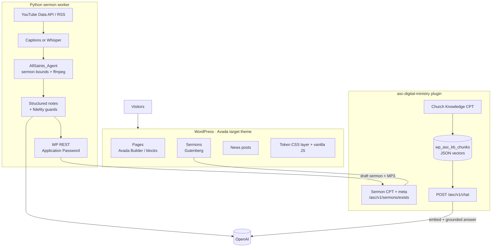

# All Saints' Church — WordPress Rebuild, Sermon Flywheel & Website Assistant

A production-minded rebuild of **[allsaintswoodbridge.org](https://www.allsaintswoodbridge.org/)** (All Saints' Church, an Anglican parish in Woodbridge, Virginia) from Squarespace to WordPress — plus two pieces of automation behind it:

1. **Sermon Flywheel** — a Python worker that turns a Sunday service on YouTube into a reviewed WordPress sermon draft (transcript → sermon boundaries → audio → structured notes → REST), reusing the parish's existing `AllSaints_Agent` scripts and removing the manual Squarespace posting step.
2. **Website Assistant**: a normal, conversational AI chat (streamed replies, remembers the conversation) that is given the curated Church Knowledge as reference. Parish facts come *only* from that knowledge.

> **Core principle:** the parish's volunteer site manager keeps running a normal WordPress site; the custom code quietly removes repetitive technical work.

---

## Architecture



| Layer | Responsibility |
|---|---|
| **Avada / Avada Builder** (target) | Page composition: hero, columns, cards, CTAs — visually editable |
| **Gutenberg** | Sermon notes, news posts, Church Knowledge-style editorial content |
| **Plugin (PHP)** | CPTs, REST endpoints, KB indexing, OpenAI calls, permissions, theme-agnostic templates |
| **CSS layer** | Tokens, fluid type/space, components (`asc-*`), sermon library, chatbot |
| **Vanilla JS** | Chat widget, video facade, filter auto-submit — ~200 lines, no framework |
| **Python worker** | YouTube detection, transcript, sermon span, audio, LLM structuring, publishing |

### Why no React / headless frontend
The person who maintains the site is a communications volunteer. A headless Next.js app would move every content change, layout tweak and new page behind a developer and a second deployment. Modern frontend practice here means semantic HTML, a token-based CSS system, fluid typography, Grid/Flexbox, container queries, accessible components and minimal JavaScript — all rendered by WordPress and editable in WordPress.

### Design system
"Modern Anglican": reverent, warm, uncluttered — derived from the existing brand (Jerusalem Cross red/blue logo, parish navy, amber; Garamond + humanist sans). Details, token table, Avada Global Options mapping and accessibility notes: **[docs/design-system.md](docs/design-system.md)**.

---

## Repository

```
.ddev/                          DDEV config (+ plugin bind mount)
AllSaints_Agent/                existing sermon scripts — untouched, imported by the worker
docs/                           legacy-agent analysis, design system
migration/                      inventory.csv/json, redirects.csv, reports/, scripts/, source/
seed/                           migrated content as block markup / JSON (pages, sermons, news, KB, nav, header/footer)
scripts/                        bootstrap.sh, seed.sh/.php, smoke-test.ps1/.sh, chat-widget-check.py
wp-content/plugins/asc-digital-ministry/   the custom plugin (includes/, assets/, templates/, patterns/, tests/)
worker/sermon_flywheel/         Python worker (sermon_worker/, tests/)
wordpress/                      WordPress core docroot (gitignored, created by bootstrap)
```

---

## Local setup (Windows / PowerShell)

Prerequisites: Docker Desktop (running), Python 3.10+, ffmpeg + yt-dlp (already used by `AllSaints_Agent`), Chrome (optional, for the browser check).

**DDEV** was installed without admin rights to `%USERPROFILE%\.local\ddev` (winget has no DDEV package). Add it to the session PATH:

```powershell
cd C:\Users\minec\OneDrive\Desktop\allsaints
$env:PATH = "$env:USERPROFILE\.local\ddev;$env:PATH"

ddev start                                   # http://allsaints.ddev.site
ddev exec bash scripts/bootstrap.sh          # WP core, settings, theme, plugin, integration user + app password
ddev exec bash scripts/seed.sh               # pages, nav, header/footer, global styles, 46 sermons, news, KB + index

cd worker\sermon_flywheel
python -m pip install -e ".[test]"           # requests, pydantic, openai, yt-dlp, pytest
cd ..\..
```

Admin login: user `admin`; the generated password is in `tmp\local-credentials.env` (gitignored). Admin URL: http://allsaints.ddev.site/wp-admin/

**OneDrive / Windows notes**
- The project lives in OneDrive and works with `performance_mode: none` (plain bind mounts). If file sync stalls, pause OneDrive syncing while DDEV runs; moving the repo out of OneDrive is the clean long-term fix.
- On a fresh clone Docker may create `wordpress/wp-content` as root when it sets up the plugin mount; bootstrap detects this and prints the one-line fix:
  `ddev exec -u root chown 1000:1000 /var/www/html/wordpress/wp-content /var/www/html/wordpress/wp-content/plugins`
- `.gitattributes` forces LF for shell scripts (CRLF breaks `bash` inside the container).
- In Git Bash, prefix container commands with `MSYS_NO_PATHCONV=1`.
- HTTPS: run `mkcert -install` once (`%USERPROFILE%\.local\ddev\mkcert.exe`) to trust `https://allsaints.ddev.site`; HTTP works without it.

### Environment variables
Copy `.env.example` → `.env` (worker) and put WordPress-side keys in `.ddev\.env`, then `ddev restart`:

```
OPENAI_API_KEY=…            # both
OPENAI_CHAT_MODEL=gpt-5-mini
OPENAI_SERMON_MODEL=gpt-5-mini
OPENAI_EMBEDDING_MODEL=text-embedding-3-small
YOUTUBE_API_KEY=…           # worker; without it the legacy RSS reader is used
YOUTUBE_CHANNEL_ID=UCOouhW9_VVwiVODtl0gDvVA
WP_BASE_URL / WP_USERNAME / WP_APPLICATION_PASSWORD   # worker; local values auto-loaded from tmp\local-credentials.env
SERMON_POST_STATUS=draft    # draft | pending | publish
```

Keys are read server-side only (constant or env); nothing secret is stored in the database or sent to browsers. After adding `OPENAI_API_KEY`, run `ddev wp asc kb reindex --force` to switch the index from offline vectors to OpenAI embeddings.

### Application Password (production)
1. Create a user **sermon-worker** with the *Editor* role (no admin rights).
2. *Users → sermon-worker → Application Passwords* → name it "Sermon Flywheel" → copy the generated password into `WP_APPLICATION_PASSWORD`.
3. Use HTTPS. The worker refuses to send credentials over plain HTTP to non-local hosts.

---

## Avada installation
**Status: pending authorized theme package/license.** No Avada package was found on this machine, and none was downloaded. The site currently runs on Twenty Twenty-Five as a temporary stand-in so everything else is testable.

When the licensed package is available:
1. *Appearance → Themes → Add New → Upload* `Avada.zip`, activate, register the purchase code, install **Avada Core** and **Avada Builder** when prompted (or `ddev wp theme install /path/Avada.zip --activate`; bootstrap auto-activates Avada if installed).
2. *Avada → Options*: set colors, typography, widths and buttons from the token table in `docs/design-system.md`.
3. Rebuild the homepage sections as Avada containers with the same CSS classes (`asc-hero`, `asc-service-times`, `asc-card-grid`, `asc-prayer`, …) and save them to the Avada Library as global containers.
4. Header/footer: rebuild in Avada Layouts using the same menu (Visit/About/Worship/Ministries/Connect/Give) and "Plan Your Visit" button.
5. Sermons need nothing: the plugin's sermon templates/shortcodes are theme-agnostic (a classic-theme archive template ships with the plugin).

---

## Migration
Audit first, then rebuild — see **[migration/reports/migration-plan.md](migration/reports/migration-plan.md)**.

```powershell
python migration\scripts\crawl_site.py      # sitemap + nav + pages + sermon JSON (polite, 0.4 s/request)
python migration\scripts\classify.py        # RULES → inventory.csv/json + redirects.csv
python migration\scripts\report_checks.py   # broken links + duplicate content reports
python migration\scripts\build_seed.py      # Squarespace HTML → Gutenberg blocks (seed/)
```
Headline numbers: 3,182 URLs inventoried; 106 useful (46 sermons + 60 pages, 30 of them merged); 3,048 dated items archived behind wildcard 301s; 154 redirect rules; 22 broken links and 1,069 duplicate-chain URLs found on the live site.

---

## AllSaints_Agent (legacy) → Sermon worker
Analysis: **[docs/legacy-sermon-agent-analysis.md](docs/legacy-sermon-agent-analysis.md)**. The worker imports the proven parts unchanged via `sermon_worker/legacy.py`: liturgical-cue sermon detection, ffmpeg audio chain, sermon-form parser, RSS reader, Sunday-date inference.

```powershell
cd worker\sermon_flywheel
python -m sermon_worker.cli check                       # config, WP auth, legacy agent, YouTube
python -m sermon_worker.cli sync --limit 1 --dry-run    # newest service, no writes
python -m sermon_worker.cli sync --limit 3              # create drafts for unseen services
python -m sermon_worker.cli process <VIDEO_ID> [--dry-run] [--form sermon-form.txt] [--title ..] [--preacher ..] [--scripture ..] [--audio-file x.mp3] [--no-audio] [--whisper]
```

Output is the parish's established **audio post** (as on the current site): title, preacher, date, Scripture (passage text via the ESV API when `ESV_API_KEY` is set), the sermon MP3 with Download, and a "Watch the full service on YouTube" link. AI "Sermon Notes" are an optional add-on (`--notes`, needs `OPENAI_API_KEY`).

Flow per video: duplicate check → transcript (captions via yt-dlp, else local Whisper) → legacy sermon-boundary detection → facts from the clergy sermon form/CLI only (missing ones flagged, never guessed) → optional Scripture text and AI notes → sermon MP3 (legacy ffmpeg chain, or `--audio-file`) → upload → create **draft**.

Failure policy: existing → skip · no transcript → don't publish · audio fails → post created and flagged "add audio" · AI notes fail → posted without notes · WP auth fails → stop loudly (exit 2) · WP write fails → not marked complete. Secrets are never logged.

Fidelity (when `--notes` is on): strict JSON schema; Scripture kept only if the book is actually mentioned in the transcript; preacher kept only if named in the transcript or supplied by the sermon form; the post's own title/preacher/Scripture never come from the AI.

Audio download needs a current yt-dlp (`pip install -U yt-dlp`; 2026.08.19 verified). YouTube may also require a JavaScript runtime (Deno), installed here via `winget install DenoLand.Deno`.

---

## Church Knowledge & assistant
- *Church Knowledge* menu: 24 verified entries, each with source page and "last verified" date (red "re-check" after 6 months).
- Saving/publishing indexes automatically (content-hash skips unchanged entries); unpublish/trash removes vectors.
- *Church Knowledge → Assistant Settings*: status, **Reindex Church Knowledge** button, site-wide toggle, office contact sentence.
- `ddev wp asc kb status | reindex [--force] | search "question"`

Test the assistant:
```powershell
Invoke-RestMethod -Method Post http://allsaints.ddev.site/wp-json/asc/v1/chat -ContentType application/json -Body '{"message":"What time is Sunday worship?"}'
Invoke-RestMethod -Method Post http://allsaints.ddev.site/wp-json/asc/v1/chat -ContentType application/json -Body '{"message":"Do you host weddings?"}'   # → not in the knowledge: says so, points to the office
```
How it works: every message goes to the model with a system prompt, the whole published Church Knowledge (about 3k tokens; above 60k characters it switches to the most relevant passages via embeddings), and the last 16 messages. Replies stream as server-sent events (`"stream": true`); omit it for a JSON `{answer}`.

Cost/abuse controls: 1,000-char messages, 16 messages of history forwarded, `max_completion_tokens` 1200, 15 requests / 5 min per IP (hashed), 500/day site-wide, friendly 429s. Without an OpenAI key the assistant replies that it is unavailable and gives the office contact.

---

## Tests
```powershell
powershell -ExecutionPolicy Bypass -File scripts\smoke-test.ps1          # everything below + environment checks
cd worker\sermon_flywheel; python -m pytest -q; cd ..\..                  # 44 Python tests (APIs mocked)
ddev wp eval-file wp-content/plugins/asc-digital-ministry/tests/run-tests.php   # 37 WordPress integration tests
python scripts\chat-widget-check.py                                      # drives the chat widget in headless Chrome (phone + desktop)
```

---

## Five-minute demo
1. **Frontend (90 s)** — Home at desktop then phone width: hero → service times → Plan Your Visit → latest sermon → ministries → news → prayer. Open a page in the editor; edit the synced *Service Times* block once and show it change on Home and Plan Your Visit.
2. **Migration (45 s)** — open `migration/inventory.csv` and `reports/migration-plan.md`: 3,182 URLs → 106 useful; redirects; the live site's broken signup and 5-month sermon backlog.
3. **Sermon flywheel (90 s)** — show `AllSaints_Agent/upload-ready/` (the old manual hand-off). Run:
   `python -m sermon_worker.cli process 6vWOq_VIX7E --title "Gospel Conformity" --preacher "The Rev. Scott Bailey" --scripture "2 Corinthians 13:5-14" --service-date 2026-05-31 --audio-file ..\..\AllSaints_Agent\upload-ready\2026-05-31-gospel-conformity\20260531-gospel-conformity.mp3`
   (if it already exists it is skipped — that's the idempotency demo; delete the draft first to recreate). Open the draft in Gutenberg, edit a paragraph, publish.
4. **Church Knowledge (45 s)** — edit "Sunday worship service times", tick *I checked this today*, update → index refreshes; show *Assistant Settings → Reindex*.
5. **Assistant (30 s)**: say "hi", ask "What time is Sunday worship?", then a follow-up like "and what should I know bringing kids?", then "Do you host weddings?" (not in the knowledge, so it points to the office).

---

## Production considerations
- Hosting with PHP 8.2+, HTTPS, daily backups; object cache optional.
- Run the worker on a schedule (Windows Task Scheduler / cron) — e.g. Monday 10:00 `sync --limit 3`. Drafts by default; switch `SERMON_POST_STATUS=publish` only after a few weeks of clean drafts.
- Put `OPENAI_API_KEY` in the host's environment or `wp-config.php` constant, not the database.
- Import `redirects.csv` with the Redirection plugin; download sermon MP3s/PDFs into the Media Library before cancelling Squarespace.
- Re-verify Church Knowledge quarterly (column shows stale entries).

## Known limitations
- Avada not installed (license pending); Twenty Twenty-Five stand-in.
- No OpenAI/YouTube keys in this environment: assistant and worker were verified in offline mode; the OpenAI paths are covered by mocked tests only.
- yt-dlp 2026.03 got HTTP 403 downloading audio from YouTube (captions still work); the demo publishes the legacy agent's existing MP3. Update yt-dlp or use `--audio-source` with a local recording.
- Historical sermons link MP3s on the Squarespace CDN (`asc_audio_url`), have no YouTube IDs, and have no summaries (none existed).
- Offline lexical retrieval misses synonyms ("kids" vs "children"); OpenAI embeddings fix this.
- Forms (prayer request, registration, pledge) and newsletter signup are not rebuilt yet; FAQ page is planned.
- Hero and building photos are limited by the resolution of existing parish photography.

## Deliberately left out
Headless/React frontend, member login, Rock RMS, custom CRM/payments/calendar/email platform, vector databases, Redis/queues/Celery, Kubernetes/AWS, CI/CD pipelines, multi-agent systems, full historical archive migration (3,048 dated items archived behind redirects instead).

## Roadmap
Avada build-out · form plugin for prayer/registration/pledge · newsletter provider integration · MP3/PDF media import · FAQ accordion page · Spanish-language page · scheduled worker + email notification to the editor when a draft is ready · Planning Center title-slide → sermon featured image.
