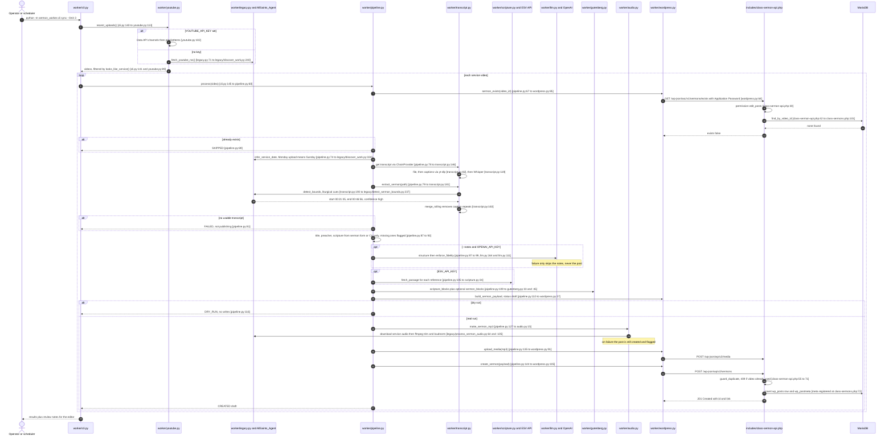
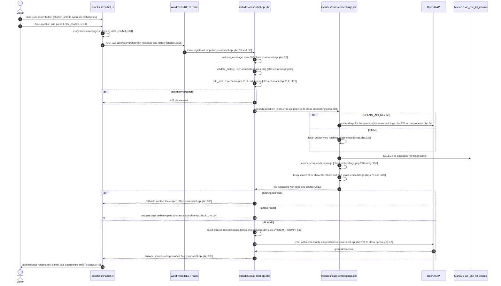
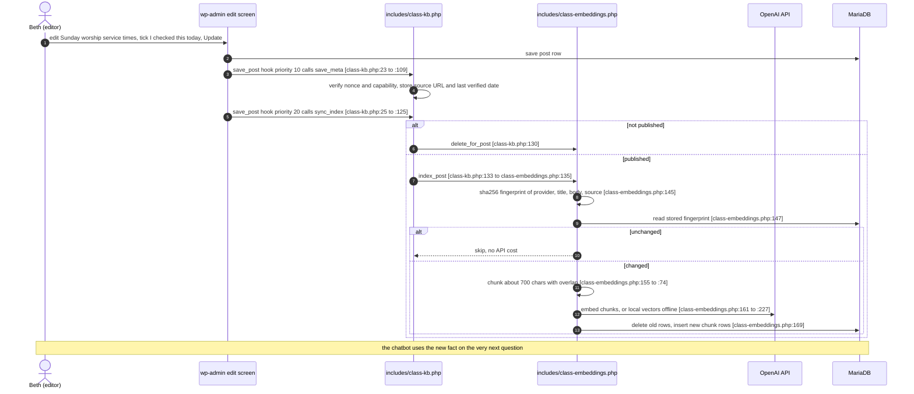
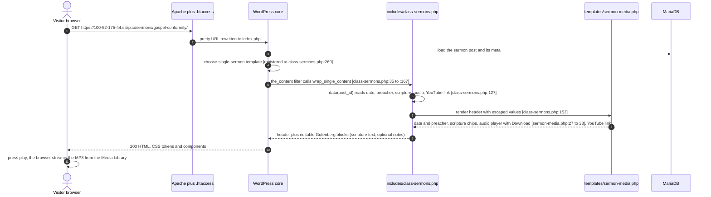

# How the All Saints' System Works: A First-Principles Tutorial

This guide assumes **zero** programming knowledge. It builds up from first principles to how *this exact project* works, so you can explain it and rebuild it like an experienced engineer.

How to read it:

- **Part 1** explains each basic building block on its own.
- **Part 2** shows how the blocks fit together in this project.
- **Part 3** walks through a real Sunday, start to finish.
- **Part 4** shows the smallest version of each key piece of code, so you could write it from scratch.
- **Part 5** has Mermaid diagrams with exact file and line citations. Paste them into <https://mermaid.live> to see them.
- **Part 6** is a glossary.

Line numbers are accurate as of 3 Oct 2026. If code is edited, numbers shift slightly; the function names stay the same.

---

## Part 1: First principles

### 1. Code, files and programs

A **program** is a list of instructions a computer follows, written in a **programming language** and saved in **files**.

This project uses four languages, each for a different job:

| Language | Job here | Example file |
|---|---|---|
| **PHP** | Runs on the web server; builds pages; answers requests | `wp-content/plugins/asc-digital-ministry/includes/class-chat-api.php` |
| **Python** | Runs on a computer as a "worker" that does the sermon chores | `worker/sermon_flywheel/sermon_worker/pipeline.py` |
| **JavaScript** | Runs *inside the visitor's browser*; makes the chat box interactive | `.../assets/js/chatbot.js` |
| **SQL** | Talks to the database (WordPress writes most of it for us) | used inside `class-embeddings.php` |

There are also two non-programming languages:

- **HTML** describes what is on a page (a heading, a paragraph, a button).
- **CSS** describes how it looks (color, size, spacing).

Code is organised into **functions**: named, reusable instructions. A function takes inputs and returns an output. For example, `cosine(a, b)` takes two lists of numbers and returns one number.

A **class** is a labelled box of related functions. `class Embeddings` holds everything about search vectors.

> Analogy: a function is a recipe ("make toast"). A class is a cookbook chapter ("Breakfast").

### 2. The web: clients, servers, requests, responses

When someone types `https://100-52-175-44.sslip.io/visit/`:

1. Their **browser** (the **client**) sends a **request** over the internet to a **server** (a computer that is always on and waiting).
2. The server runs code and sends back a **response**: a **status code** plus content, usually HTML.

The parts of a URL:

- `https://`: the protocol. The `s` means the connection is **encrypted (TLS)**.
- `100-52-175-44.sslip.io`: the **domain**. **DNS**, the internet's phone book, turns it into the server's **IP address**, `100.52.175.44`.
- `/visit/`: the **path**, meaning which page.

Status codes used in this project:

| Code | Meaning | Where you'll see it |
|---|---|---|
| 200 | OK | Normal pages |
| 201 | Created | The worker created a sermon |
| 301 | Moved permanently (redirect) | `http://` → `https://`; old Squarespace URLs → new ones |
| 400 | Bad request (your input is wrong) | Empty chat message |
| 401 | Not logged in | Anonymous user calling the sermon check |
| 404 | Not found | A page that doesn't exist |
| 409 | Conflict | Trying to create a sermon that already exists |
| 429 | Too many requests | Chat rate limit |

Requests have a **method**:

- **GET**: read something.
- **POST**: send or create something.

### 3. HTML, CSS, JavaScript and "progressive enhancement"

- **HTML** is the skeleton: `<h1>Welcome</h1><p>Sunday 8:15</p>`.
- **CSS** is the clothes: `h1 { color: navy; }`.
- **JavaScript** is the muscles: "when the button is clicked, open the chat."

**Progressive enhancement** means the page works with HTML and CSS alone, and JavaScript only adds extras. If JavaScript fails, the visitor still sees service times.

**Design tokens** are named values reused everywhere, for example `--asc-color-primary: #b3141e`. Change the token once and every button changes. They live in `assets/css/tokens.css`.

### 4. Servers, PHP and WordPress

A plain website is a folder of fixed files. A **dynamic** website builds each page *when it's requested*.

On our server:

- **Apache** (web server software) receives the request.
- Apache hands it to **PHP**.
- PHP runs **WordPress**.
- WordPress reads the **database** and produces HTML.

**WordPress** is a large PHP program that already solves the common problems: pages, users, logins, a visual editor, media uploads. We don't rewrite those. We **extend** WordPress with:

- a **theme**, which controls the look. The target is Avada; today the stand-in is Twenty Twenty-Five.
- a **plugin**, which adds features. Ours is `asc-digital-ministry`.

### 5. Databases

A **database** stores information in **tables** (like spreadsheets): rows are records, columns are fields. Ours is **MariaDB**.

The tables that matter here:

- `wp_posts`: every page, post, sermon and knowledge entry is a row, with columns such as `post_title`, `post_content`, `post_type` (e.g. `sermon`) and `post_status` (`draft`/`publish`).
- `wp_postmeta`: extra labelled facts attached to a post, called **post meta**. For example, `asc_preacher = "The Rev. Scott Bailey"`.
- `wp_asc_kb_chunks`: **our own table**, holding the chatbot's searchable passages and their vectors (see principle 11).

### 6. WordPress concepts you must know

1. **Post types.** WordPress stores everything as "posts" with a type: `page`, `post` (news), plus our **custom post types** `sermon` and `church_kb`. We create them with `register_post_type()` (`class-sermons.php:45`, `class-kb.php:33`).
2. **Post meta**, registered so the REST API can read and write it: `register_post_meta()` (`class-sermons.php:72`).
3. **Hooks (actions and filters).** This is the most important WordPress idea. WordPress announces moments: "I'm starting up" (`init`), "a post was just saved" (`save_post`), "here's the page content, want to change it?" (`the_content`). Your plugin **hooks in** by saying "when that happens, run my function."
   - `add_action( 'init', ... )` means "run my code at that moment."
   - `add_filter( 'the_content', ... )` means "let me edit this value before it's used."
   - Example: `class-kb.php:25` says "when a knowledge entry is saved, re-index it."
4. **Blocks (Gutenberg).** Page content is a list of blocks (heading, paragraph, image), stored as HTML with comments like `<!-- wp:paragraph -->`. That is why Beth can edit them visually.
5. **Shortcodes.** A tag like `[asc_latest_sermon]` placed in a page is replaced by our PHP output when the page renders (`class-sermons.php:38`).
6. **Templates.** These decide the overall layout of a kind of page, such as the sermon archive (`class-sermons.php:246`).

### 7. APIs, REST and JSON

An **API** is a doorway that lets one program talk to another.

A **REST API** does this over web requests: a **method** plus a **URL path** (the **endpoint**), with data sent as **JSON**. JSON is a simple text format for data:

```json
{ "message": "What time is Sunday worship?", "history": [] }
```

WordPress has a built-in REST API at `/wp-json/`. We added two endpoints:

- `POST /wp-json/asc/v1/chat`: the chatbot (`class-chat-api.php:30`).
- `GET /wp-json/asc/v1/sermons/exists?youtube_video_id=...`: "do we already have this sermon?" (`class-sermon-api.php:26`).

The worker creates sermons through WordPress's own endpoint, `POST /wp-json/wp/v2/sermons`. It exists automatically because the post type has `show_in_rest => true`.

**Authentication** answers "who are you?"; **authorisation** answers "are you allowed?".

- The worker logs in with an **Application Password**: a separate password just for this robot user, sent in each request (`wordpress.py:64`).
- Each endpoint has a **permission check**:
  - chat is public (`class-chat-api.php:33`);
  - the sermon check needs an editor (`class-sermon-api.php:30`).

### 8. Python, scripts and the worker

The **worker** is a Python program you run from a terminal:

```
python -m sermon_worker.cli sync
```

It's a **CLI** (command-line interface): commands typed as text instead of clicked.

It's split into **modules** (files), each with one job:

| Module | Job |
|---|---|
| `youtube.py` | Find videos |
| `transcript.py` | Get text |
| `llm.py` | Ask AI to organise it |
| `gutenberg.py` | Turn it into blocks |
| `wordpress.py` | Talk to the site |
| `pipeline.py` | Run the steps in order |

**Exceptions** are how code says "something went wrong." Raising one stops the current step, and the caller decides what to do. For example, `TranscriptUnavailable` means "don't publish" (`pipeline.py:81`).

### 9. From video to sermon text

A YouTube video can have **captions**: text plus **timestamps**, e.g. `00:21:36 → "You may be seated."`.

We download the captions with **yt-dlp** (a downloading tool). If there are no captions, the fallback is **Whisper**, a speech-to-text program that the original `AllSaints_Agent` uses.

The full service is about 90 minutes, but we only want the sermon. The legacy agent's clever piece, `detect_sermon_bounds.py`, looks for liturgical **cues**:

- just before the sermon: "The Gospel of the Lord", then "You may be seated" (`START_CUES`, line 16);
- just after it: "Let us stand… We believe in one God" (the Nicene Creed; `END_CUES`, line 33).

It scores the candidates and picks a start and an end time (`detect()`, line 237).

YouTube's automatic captions repeat each phrase about three times as they "roll." `merge_rolling()` (`transcript.py:163`) removes the overlap.

### 10. Large Language Models (LLMs)

An **LLM** (e.g. OpenAI's GPT-5-mini) is a program that predicts text. You send a **prompt** (instructions plus input) and get text back.

In this project the AI is an **optional add-on** (`--notes`): it can add written "Sermon Notes" under a sermon. The sermon post itself (title, preacher, Scripture, audio) never depends on it, because All Saints' publishes **audio posts** and those facts come from the clergy, not the AI.

Two problems, and our fixes:

1. **Free-form text is hard for programs to use.** So we demand **structured output**: JSON that must match a **schema** (a template of required fields and types). See `llm.py:164` (`response_format = json_schema`). We then **validate** it with Pydantic (`SermonNotes`, `llm.py:32`). Anything malformed is rejected, and the sermon is posted without notes.
2. **Hallucination.** LLMs can confidently invent things, such as a Bible verse the preacher never read. So after the AI answers, our own code double-checks it (`enforce_fidelity`, `llm.py:111`):
   - **Scripture** is kept only if the book is actually mentioned in the transcript (`book_mentioned`, `llm.py:97`).
   - **The preacher's name** is kept only if it appears in the transcript or comes from a trusted source (`llm.py:125`).
   - **Trusted metadata** (title, preacher or scripture typed in by clergy) always overrides the AI.

Rule: **the AI organises; it never decides facts.**

### 11. Embeddings and retrieval (how the chatbot "finds" answers)

A computer can't compare meanings directly, so we turn text into an **embedding**: a long list of numbers (a **vector**) where similar meanings give similar numbers.

**Cosine similarity** measures how alike two vectors are, from 1 (same direction) down to 0 (unrelated). A tiny example with 3 numbers instead of 1,536:

```
"Sunday service time"  → [0.9, 0.1, 0.0]
"When is worship?"     → [0.8, 0.2, 0.1]   cosine ≈ 0.98  (very similar)
"Food pantry hours"    → [0.1, 0.0, 0.9]   cosine ≈ 0.12  (unrelated)
```

**Retrieval** means: embed the visitor's question, compare it to every stored passage, and keep the best matches above a **threshold**. If nothing clears the threshold, we don't answer.

This is called **RAG (Retrieval-Augmented Generation)**: we *retrieve* our verified facts first, then let the AI *generate* an answer **only from those facts**.

**Chunking**: long entries are cut into ~700-character passages that overlap slightly, so each vector represents one focused idea (`chunk()`, `class-embeddings.php:74`).

Without an OpenAI key we use a simple offline vector based on word counts (`local_vector`, `class-embeddings.php:235`). It matches words, not meanings, so "kids" won't match "children".

### 12. Idempotency (doing it twice is safe)

**Idempotent** means running the same operation again causes no extra effect. We use the **YouTube video ID** (e.g. `6vWOq_VIX7E`) as the sermon's unique key, and check it twice:

1. The worker asks first: "does this video already have a sermon?" (`pipeline.py:67`).
2. WordPress also refuses a duplicate with **409** (`class-sermon-api.php:66-71`), even if two workers run at once.

### 13. Security basics

- **Secrets** (API keys, passwords) live in **environment variables** or files ignored by Git, never in code (`Plugin::config`, `class-plugin.php:35`).
- **HTTPS** encrypts traffic. The certificate comes free from **Let's Encrypt** via **certbot**.
- **Escaping**: anything shown on a page goes through `esc_html()`/`esc_url()`, so text can't inject code.
- **Rate limiting**: one visitor can't spam the chat and run up AI costs (`rate_limit`, `class-chat-api.php:177`).
- **Least privilege**: the worker's user is an *Editor*, not an Admin.

### 14. Where it runs: local development vs hosting

- **Local**: **Docker** runs isolated mini-computers (**containers**) on your laptop. **DDEV** sets up the WordPress ones for you (a web container and a database container). The address `allsaints.ddev.site` only points to your own machine.
- **Hosting**: an **AWS Lightsail** server, a rented always-on Linux computer at `100.52.175.44`. The domain name `100-52-175-44.sslip.io` points to that IP for free.
- **Deployment** means copying the database and files there (`scripts/deploy/export.sh` → `scp` → `import.sh`).

### 15. Tests

A **test** is code that runs other code and checks the result automatically, for example "an empty chat message must return 400."

- 44 Python tests (`worker/sermon_flywheel/tests/`).
- 37 WordPress tests (`wp-content/plugins/asc-digital-ministry/tests/run-tests.php`).

**Mocks** are fake versions of outside services (fake OpenAI, fake WordPress), so tests are free and repeatable.

---

## Part 2: Putting the pieces together

```
            ┌──────────────── Visitors' browsers (HTML + CSS + JS) ────────────────┐
            │                                                                      │
   pages, sermons, news                                     chat widget (chatbot.js)
            │                                                         │  POST /asc/v1/chat
            ▼                                                         ▼
 ┌──────────────────────── WordPress on Apache + PHP ────────────────────────────┐
 │  Theme (look)      asc-digital-ministry plugin (our features)                 │
 │                    ├─ Sermons CPT + templates + /asc/v1/sermons/exists        │
 │                    ├─ Church Knowledge CPT → chunks → vectors                 │
 │                    └─ Chat API → retrieve → (OpenAI) → answer + sources       │
 └──────────────────────────────┬──────────────────────────────────────────────────┘
                                │ SQL
                         MariaDB database (wp_posts, wp_postmeta, wp_asc_kb_chunks)
                                ▲
            REST + Application Password (HTTPS)
                                │
 ┌──────────── Python sermon worker (runs on your PC or a server) ────────────────┐
 │ YouTube → captions/Whisper → AllSaints_Agent finds sermon → AI notes          │
 │ → fidelity checks → Gutenberg blocks → upload MP3 → create DRAFT sermon       │
 └──────────────────────────────────────────────────────────────────────────────────┘
```

**Who does what:**

- **Beth (editor)** uses WordPress screens only: edits pages, reviews sermon drafts, updates Church Knowledge.
- **The worker** does the repetitive sermon chores and stops at a *draft*, so a human always approves.
- **The chatbot** answers only from Church Knowledge, which Beth controls.

---

## Part 3: A practical example: one Sunday, end to end

### Sunday 11 a.m.: the service is livestreamed to YouTube
Video ID `6vWOq_VIX7E`, titled "Trinity Sunday 2026," uploaded on Monday, 1 June.

### Monday: the worker runs
The command is `python -m sermon_worker.cli sync --limit 3`, run by hand today and on a schedule later. The goal is the parish's usual **audio post**: title, preacher, date, Scripture, the sermon MP3 (play + download), and a "Watch the full service on YouTube" link.

1. **Find new services.** `cli.py:140` asks YouTube for recent uploads. Without an API key, it reuses the legacy RSS reader (`legacy.py:71` → `discover_work.py:240`). `looks_like_service` keeps "Sunday…" titles (`youtube.py:89`).
2. **Skip duplicates.** `pipeline.py:67` asks WordPress `GET /asc/v1/sermons/exists?youtube_video_id=6vWOq_VIX7E`. WordPress checks the database (`class-sermon-api.php:42`) and answers `{"exists": false}`.
3. **Work out the Sunday date.** The legacy rule "uploaded Monday ⇒ preached Sunday" gives `2026-05-31` (`pipeline.py:74` → `discover_work.py:324`).
4. **Get the transcript.** `pipeline.py:78` tries the providers in order: a local file, then YouTube captions (`transcript.py:82`), then Whisper. The transcript's main job is to **find the sermon** inside the 90-minute service.
5. **Find the sermon inside the service.** `extract_sermon` (`pipeline.py:79` → `transcript.py:181`) calls the legacy detector (`transcript.py:190` → `detect_sermon_bounds.py:237`). It finds "You may be seated" at 00:21:36 and "We believe in one God" at 00:47:01, with high confidence. `merge_rolling` (`transcript.py:193`) cleans 9,243 repeated caption words down to a 3,199-word sermon.
6. **Gather the facts, without guessing.** Title, preacher and Scripture come only from trusted input: the clergy sermon form (`--form`) or the command line (`pipeline.py:87-89`). Missing ones are **flagged for Beth**, not invented. For example, with no title the worker uses the YouTube service name and says so.
7. **Scripture text (optional).** With an `ESV_API_KEY`, `pipeline.py:105` fetches the passage (`scripture.py:34`) and `gutenberg.py:33` lays it out exactly like the old site: verse numbers, "(ESV)", copyright notice. Without a key, the reference alone is shown.
8. **AI notes (optional, `--notes`).** If enabled, `pipeline.py:97-99` asks OpenAI for structured notes, then `enforce_fidelity` (`llm.py:111`) removes anything not supported by the transcript. A failure here never blocks the post.
9. **Assemble the request.** `pipeline.py:110` → `wordpress.py:27` packages everything: title, content blocks, `status: "draft"`, and meta (date, preacher, Scripture, video ID, transcript).
10. **Make the sermon MP3.** `pipeline.py:127` downloads the service audio and trims it to the sermon with the legacy ffmpeg chain (`audio.py:15` → `process_sermon_audio.py:105`): a 26-minute MP3 with title and date tags. If this fails, the post is still created and flagged "please add audio."
11. **Upload and create.** `pipeline.py:135` uploads the MP3 (`POST /wp/v2/media`), then `pipeline.py:144` creates the sermon (`POST /wp/v2/sermons`). WordPress checks the Application Password and the duplicate guard (`class-sermon-api.php:55`), saves the row and meta, and replies **201** with the new post ID.

### Monday 9 a.m.: Beth
She opens *Sermons → Drafts*, plays the audio, fills in anything flagged (e.g. the preacher), and clicks **Publish**.

The homepage's "Latest Sermon" (`[asc_latest_sermon]`, `class-sermons.php:206`) now shows it automatically. The sermon page shows date, preacher, Scripture, the audio player with **Download**, and a **Watch the full service on YouTube** link, then any Scripture text or notes (`wrap_single_content`, `class-sermons.php:167` → `templates/sermon-media.php`).

### Tuesday: a visitor asks the chatbot "What time is Sunday worship?"

1. `chatbot.js:84` (`ask`) shows their message and a typing indicator, then `chatbot.js:96` sends `POST /wp-json/asc/v1/chat`.
2. WordPress validates the input (`class-chat-api.php:50`) and runs the rate limit (`class-chat-api.php:85` → `:177`).
3. `Embeddings::search` (`class-chat-api.php:101` → `class-embeddings.php:268`) turns the question into a vector (`:270`), scores every stored passage with cosine similarity (`:278`), keeps those above the threshold (`:279`), and sorts them (`:289`).
4. **If nothing matches:** reply with the polite "contact the office" fallback (`class-chat-api.php:106`).
5. **If there's a match:** build a context of the matching facts (`:119`) plus strict rules (`SYSTEM_PROMPT`, `:19`), ask OpenAI (`:126`), and return the answer with source links (`:130`). Without an OpenAI key, it returns the best passage directly (`:111-114`).
6. `chatbot.js:46` (`addMessage`) shows the answer and the "Learn more" link.

### Wednesday: the 8:15 service time changes
Beth edits the "Sunday worship service times" entry under *Church Knowledge*, ticks "I checked this today", and clicks Update. On save:

1. The save hook (`class-kb.php:25`) calls `sync_index` (`:125`), which calls `Embeddings::index_post` (`:133`).
2. A **fingerprint (hash)** of the text is computed (`class-embeddings.php:145`). It differs from the stored one (`:147`), so the old passages are deleted.
3. The text is chunked (`:155`), embedded (`:161`) and saved (`:169`).

The chatbot knows the new time immediately. No developer is needed.

---

## Part 4: Writing it from scratch (minimal versions)

These are deliberately tiny. The real files add validation, security and error handling around the same core.

### 4.1 A WordPress plugin that adds a "Sermon" type and a REST endpoint (PHP)

```php
<?php
/* Plugin Name: Mini Sermons */

add_action( 'init', function () {                       // hook: "WordPress is starting"
    register_post_type( 'sermon', array(                 // new content type
        'public' => true, 'has_archive' => true,
        'show_in_rest' => true, 'label' => 'Sermons',
        'supports' => array( 'title', 'editor' ),
    ) );
    register_post_meta( 'sermon', 'asc_youtube_video_id', array(
        'type' => 'string', 'single' => true, 'show_in_rest' => true,
        'auth_callback' => fn() => current_user_can( 'edit_posts' ),
    ) );
} );

add_action( 'rest_api_init', function () {               // hook: "REST API is starting"
    register_rest_route( 'asc/v1', '/sermons/exists', array(
        'methods'  => 'GET',
        'permission_callback' => fn() => current_user_can( 'edit_posts' ),
        'callback' => function ( $request ) {
            $ids = get_posts( array( 'post_type' => 'sermon', 'post_status' => 'any',
                'meta_key' => 'asc_youtube_video_id', 'meta_value' => $request['youtube_video_id'],
                'fields' => 'ids' ) );
            return array( 'exists' => ! empty( $ids ) );
        },
    ) );
} );
```

Real version: `class-sermons.php:44-82`, `class-sermon-api.php:25-74`.

### 4.2 Cosine similarity and search (PHP)

```php
function cosine( array $a, array $b ): float {
    $dot = $na = $nb = 0;
    foreach ( $a as $i => $x ) { $dot += $x * $b[$i]; $na += $x * $x; $nb += $b[$i] * $b[$i]; }
    return $dot / ( sqrt( $na ) * sqrt( $nb ) );
}
// search = embed the question, score every stored passage, keep scores ≥ threshold, sort high→low
```

Real version: `class-embeddings.php:252` (`cosine`) and `:268` (`search`).

### 4.3 The chat widget (JavaScript)

```js
form.addEventListener('submit', async (event) => {
  event.preventDefault();                                   // don't reload the page
  const res = await fetch('/wp-json/asc/v1/chat', {
    method: 'POST', headers: { 'Content-Type': 'application/json' },
    body: JSON.stringify({ message: input.value, history: [] }),
  });
  const data = await res.json();
  const p = document.createElement('p');
  p.textContent = data.answer;                              // textContent = safe (no code injection)
  log.append(p);
});
```

Real version: `chatbot.js:84-121`.

### 4.4 The worker talking to WordPress (Python)

```python
import requests
session = requests.Session()
session.auth = ("sermon-worker", "xxxx xxxx xxxx xxxx")      # Application Password
base = "https://100-52-175-44.sslip.io/wp-json"

if not session.get(f"{base}/asc/v1/sermons/exists", params={"youtube_video_id": vid}).json()["exists"]:
    r = session.post(f"{base}/wp/v2/sermons", json={
        "title": "Gospel Conformity", "content": blocks, "status": "draft",
        "meta": {"asc_youtube_video_id": vid}})
    print(r.status_code)   # 201 = created
```

Real version: `wordpress.py:56-115`, `pipeline.py:60-150`.

### 4.5 Optional AI notes: strict JSON, then not trusting it (Python)

```python
resp = client.chat.completions.create(
    model="gpt-5-mini",
    messages=[{"role": "system", "content": RULES}, {"role": "user", "content": transcript}],
    response_format={"type": "json_schema", "json_schema": SCHEMA},   # must match the template
)
notes = SermonNotes.model_validate_json(resp.choices[0].message.content)  # reject if malformed
notes.scripture_references = [r for r in notes.scripture_references if book_mentioned(r, transcript)]
```

Real version: `llm.py:144-174` and `llm.py:111-136`.

### Build order if starting from zero
1. Audit the old site (`migration/scripts/crawl_site.py`).
2. Set up local WordPress (DDEV + `scripts/bootstrap.sh`).
3. Write the plugin: post types and meta, then the REST endpoints.
4. Add the CSS tokens and components.
5. Write the worker: YouTube → transcript → legacy bounds → AI → blocks → REST.
6. Build the knowledge base: table → chunk → embed → search → chat endpoint → widget.
7. Write the tests.
8. Deploy (`scripts/deploy/`).

---

## Part 5: Sequence diagrams (copy into https://mermaid.live)

How to read them:

- Each vertical line is a **participant**: a person, file or system.
- Arrows are messages or calls, in time order from top to bottom.
- Notes cite `file:line`.
- Paths are shortened:
  - `includes/` = `wp-content/plugins/asc-digital-ministry/includes/`
  - `worker/` = `worker/sermon_flywheel/sermon_worker/`
  - `legacy/` = `AllSaints_Agent/automation/`

### Diagram 1: Sermon Flywheel (YouTube → WordPress audio post)



### Diagram 2: Visitor asks the chatbot



### Diagram 3: Beth updates a Church Knowledge fact



### Diagram 4: Visitor opens a sermon page



---

## Part 6: Glossary

| Term | Meaning |
|---|---|
| API / endpoint | A doorway for programs; one specific URL + method |
| Application Password | A WordPress password just for one automated tool; revocable |
| Block (Gutenberg) | One editable piece of content (heading, paragraph, image) |
| Chunk | A short slice of a longer text, embedded separately |
| CLI | A program you run by typing commands |
| Container / Docker / DDEV | Isolated mini-computers; DDEV sets up WordPress ones |
| Cosine similarity | A 0–1 score of how alike two vectors are |
| CPT (custom post type) | A new kind of WordPress content (sermon, church_kb) |
| DNS | Turns names into IP addresses |
| Embedding / vector | A list of numbers representing text meaning |
| Exception | A signal that something failed, so the caller can react |
| Hash / fingerprint | A short code that changes whenever the text changes |
| Hook (action/filter) | A WordPress "moment" your code can attach to |
| Idempotent | Safe to run twice with no extra effect |
| JSON / schema | A data text format / the required shape of that data |
| LLM | An AI model that generates text |
| Meta (post meta) | Extra labelled facts attached to a post |
| Mock | A fake service used in tests |
| RAG | Retrieve your facts first, then generate from them only |
| REST | Web-request style of API (GET/POST + JSON) |
| Shortcode | `[tag]` in content replaced by code output |
| Status code | The 3-digit result of a web request (200, 404, …) |
| TLS / HTTPS / certbot | Encryption / secure web / tool that gets free certificates |
| Token (design) | A named reusable style value, e.g. a brand color |
